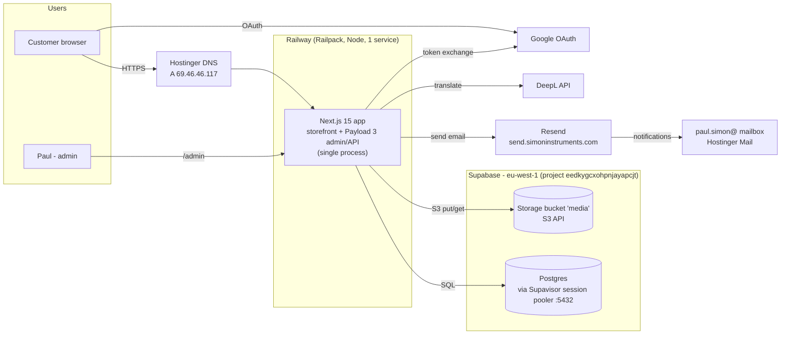
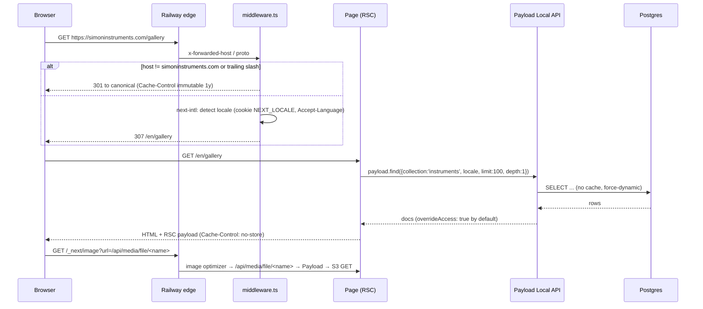
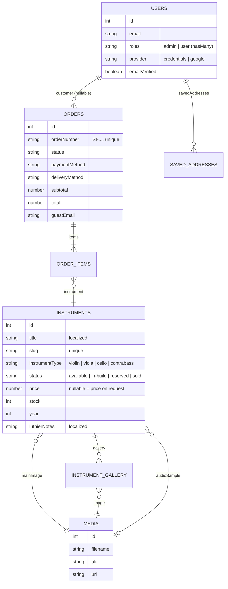
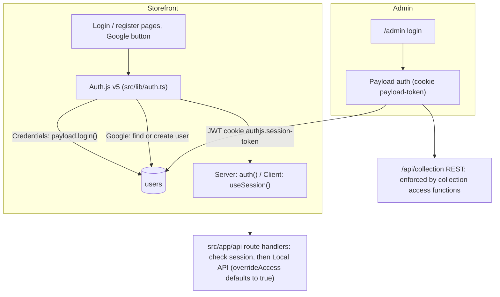

# Architecture

Status: describes `main` at `6c4b326` (2026-05-21). Live system observed 2026-10-24.

## 1. System context

Everything runs in **one Next.js process**.

- Payload is a library inside the Next app. It is not a separate service. Its admin UI is mounted at
  `/admin` and its REST API at `/api/[...slug]`. GraphQL is disabled.
- The storefront's own route handlers live under `src/app/api/*`.
- Next.js resolves the more specific route first, so `/api/checkout/...` wins over Payload's
  catch-all.

## 2. Route groups

| Group | Path | Owner | Notes |
|---|---|---|---|
| `src/app/(frontend)/[locale]/*` | `/{locale}/...` | us | Storefront. Its own `<html>`, fonts and providers |
| `src/app/(payload)/admin/*` | `/admin/*` | Payload (generated) | Admin panel. Do not edit generated files |
| `src/app/(payload)/api/[...slug]` | `/api/<collection>/*` | Payload (generated) | REST for every collection |
| `src/app/api/*` | `/api/{account,auth,checkout,contact,health,orders,register}` | us | Custom route handlers |
| `src/app/layout.tsx` | n/a | us | Passthrough. Each group renders its own `<html>` |

## 3. Request lifecycle (storefront)

Things to know:

- **The middleware matcher skips `/api`, `/admin`, `/_next`, `/_vercel` and any path with a dot.** API
  routes therefore get no locale handling and no canonical-host redirect.
- **The canonical host is hard-coded** to `simoninstruments.com` (`src/middleware.ts`). Any other
  host gets a 301 to production, with a one-year immutable cache header. That includes a Railway
  `*.up.railway.app` URL or a future staging domain. A preview or staging deploy cannot serve pages
  until this becomes env-driven.
- **Nothing is cached.**
  - Pages that read the DB declare `export const dynamic = 'force-dynamic'`. That was a workaround:
    the build could not reach the DB (see ADR-0005).
  - The other pages turn dynamic anyway, because next-intl reads request headers and there's no
    `generateStaticParams`/`setRequestLocale`.
  - Every view is a full server render plus DB queries. Measured TTFB: home ~0.5s, gallery ~1.7s.
- **Media is proxied.** The S3 plugin runs without `disablePayloadAccessControl`, so file URLs are
  `/api/media/file/<filename>`. Every image passes through Payload, then gets re-optimized by
  `/_next/image`.
  - The `media` bucket is publicly readable. Supabase serves the same file in ~0.5s; through the app
    it takes ~2s (measured).

## 4. Data model (summary)

Full field-level reference: `src/collections/AGENTS.md`. Behaviour: `domain-and-business-logic.md`.

- **Postgres via Drizzle.** Payload generates tables:
  - `instruments` plus `instruments_locales` for localized fields.
  - `instruments_gallery`, `orders_items`, `users_saved_addresses`, `users_roles`.
  - `payload_migrations`, `payload_preferences`, `payload_locked_documents`.
- **Localization:**
  - Only `instruments.title` and `instruments.luthierNotes` are localized.
  - `fallback: true` means a missing translation renders the English value silently.
- **IDs are serial integers.** Auth.js stores the Payload user id as a string in its JWT. Code
  converts with `Number(...)` at the boundaries.

## 5. Authentication and authorization

There are two independent auth stacks. Both use the same `users` collection.

**Storefront (Auth.js v5 beta)**

- **Credentials provider**: refuses accounts whose email isn't verified, then calls
  `payload.login()`.
- **Google provider** (`checks: ['nonce']`): the `signIn` callback finds or creates the matching
  Payload user. New users get a random password.
- **Session callback:** the session strategy is a JWT. The `session` callback re-reads the user from
  Postgres **on every `auth()`/`useSession()` call**, to refresh name, phone, roles and address.
- **Custom route handlers** call `auth()` and then use the Local API. The Local API ignores collection
  access, so every handler must enforce ownership itself. See `src/app/api/AGENTS.md`.

**Admin (Payload)**

- `/admin` uses Payload's own login, sessions and `payload-token` cookie.
- The `roles` field (`admin` | `user`) is saved to the JWT.
- Collection access functions check `roles.includes('admin')` for writes on `instruments` and
  `orders`.
- Access rules on `users` and `media`, including who may use the admin panel, need hardening. This
  is tracked privately; see the root `AGENTS.md` §2.

**Registration and email verification**

- `POST /api/register` creates `provider: credentials, emailVerified: false`.
- `POST /api/auth/send-otp` stores a 6-digit code (10-minute expiry) on the user and emails it.
- `POST /api/auth/verify-otp` sets `emailVerified: true`.
- Payload's own `auth.verify` feature is **not** used.

## 6. Internationalization

- **UI strings**: next-intl with `messages/{locale}.json` (513 keys each).
  - Locale is always in the URL (`localePrefix: 'always'`).
  - Detection order: `NEXT_LOCALE` cookie, then `Accept-Language`, then `en`.
- **Content**: Payload localization on two instrument fields.
  - The `autoTranslateInstrument` `afterChange` hook calls DeepL for the 7 non-English locales.
  - It runs **on create only**, and only when saving in `en`.
  - It writes each translation with a nested `payload.update`, using `skipAutoTranslate`.
- **Emails**: only the OTP email is localized. Order, reservation and shipping emails are English.
  Notifications to Paul are Romanian (contact form) or English (reservations).
- **Fonts**:
  - Inter and Playfair Display (latin) are loaded with `next/font`.
  - Noto Sans JP/KR are loaded with the latin subset only, so they never cover CJK glyphs.
  - None of these are applied today because of a CSS variable mismatch. See `known-issues.md`.

## 7. Background work and side effects

There is no queue, cron or job runner. All side effects run inline in the request:

| Trigger | Side effect | Where |
|---|---|---|
| Instrument created (en) | 7 DeepL calls + 7 nested updates | `src/hooks/autoTranslate.ts` |
| Reservation created | Instruments → `reserved`; 2 emails, fire-and-forget **after** the response | `src/app/api/checkout/create-reservation/route.ts` |
| Order status → `shipped` (delivery only) | Shipping email to the customer | `src/collections/Orders.ts` `afterChange` |
| Contact form | Email to Paul | `src/app/api/contact/route.ts` |
| Register / resend code | OTP email | `src/app/api/auth/send-otp/route.ts` |

Fire-and-forget emails can be lost if the process is recycled. Nothing retries a failed send; the
only trace is a `console.error` in the Railway logs.

## 8. Observability

Details: `docs/observability/` (tracking plan, runbook).

- **Logs**: JSON lines to stdout (`src/lib/observability/logger.ts`), indexed by Railway. Each line
  carries a `request_id` (Railway's `x-railway-request-id` when present). The message and fields
  are scrubbed: no emails, names, phone numbers, tokens or query strings. Older code still uses
  `console.*`, and Next.js and Payload print uncaught errors to stderr themselves, unscrubbed.
  Payload's logger redaction is tracked separately.
- **Errors**: uncaught server errors (`onRequestError` in `src/instrumentation.ts`), email failures
  (`sendEmail`) and `captureError()` calls go to PostHog error tracking, after scrubbing. Database
  errors embed query parameters, so the scrubber redacts them. Browser exceptions are captured too.
  API routes that catch their own errors, Payload's REST errors and the hold sweep still need
  `captureError()` calls (see `docs/observability/tracking-plan.md`).
- **Analytics**: PostHog EU (`src/instrumentation-client.ts`). Nothing is stored in the browser
  (`persistence: 'memory'`), visitors are never identified, session replay is off, and nothing runs
  on `/admin`. The country comes from GeoIP; the IP is discarded at ingestion.
- **Health**: `/api/health` checks the database (503 when it's down).
- **Uptime**: Better Stack checks home, gallery, health and admin every 3 minutes from 4 regions,
  plus SSL and domain expiry and the nightly backup heartbeat.

## 9. Security model (summary)

The repository is public, so this section only describes the model. Specific findings are tracked
privately.

- **Trust boundary**: the browser is untrusted. Only these may read or write data:
  - collection access functions (the REST surface; helpers in `src/access/`), and
  - route handlers that check `auth()` and enforce ownership.
- **Secrets** live only in Railway service variables and a developer's local `.env`, which is
  git-ignored. Git history has been checked and contains no secrets (2026-10-24).
- **Headers** (`next.config.mjs` → `headers()`): HSTS (6 months, apex only: mail subdomains are
  Hostinger/Resend, so no `includeSubDomains`, no `preload`), `nosniff`,
  `X-Frame-Options: DENY`, `Referrer-Policy: strict-origin-when-cross-origin`, a restrictive
  `Permissions-Policy` and COOP. The CSP runs in **report-only** mode; violations are logged by
  `/api/csp-report` (`csp: <directive> blocked <url> on <page>`). Enforce it once the reports are
  clean. `x-powered-by` is off.
- **Database**: row-level security is on for every `public` table, and the Supabase `anon` and
  `authenticated` roles have no grants. Payload's role owns the tables and isn't affected.
- **Abuse controls**: rate limiting and bot protection for public forms are tracked in the private
  audit.
