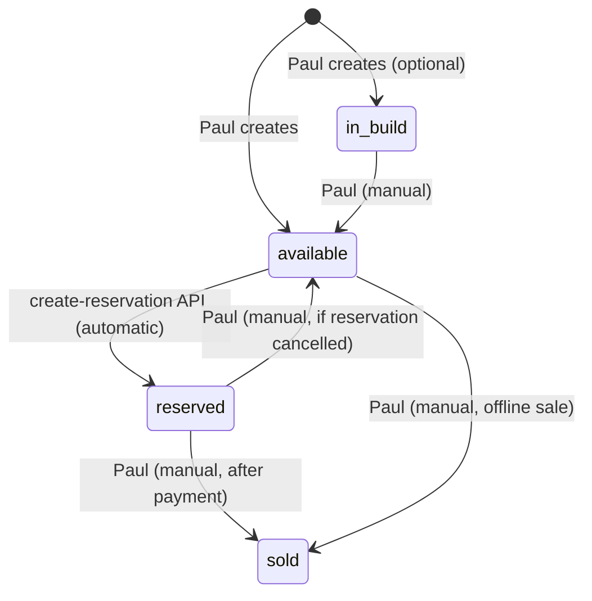
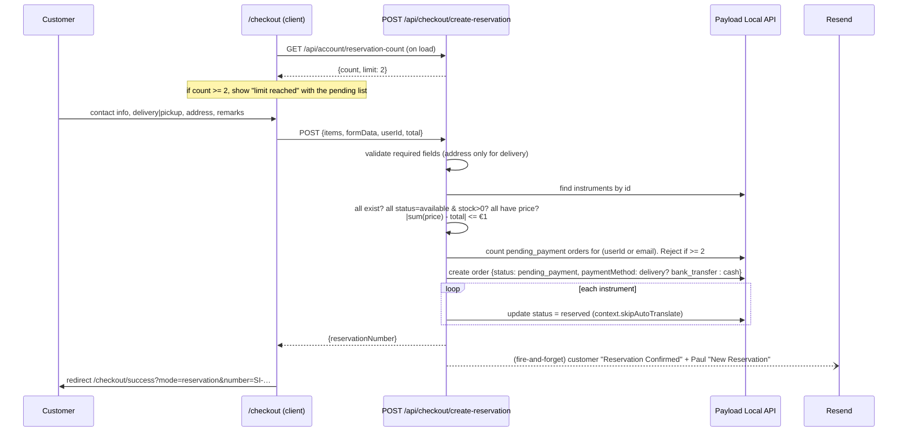
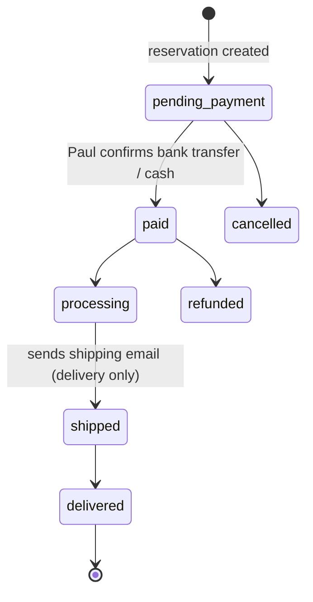

# Domain and business logic

How the business works, and how the code models it. Code references are to `main` @ `6c4b326`. Live
data was sampled from the public `/api/instruments` endpoint on 2026-10-24.

## 1. The business

- **Who**: Paul and Ecaterina Simon, luthiers in Reghin, Mureș County, Romania. Workshop founded
  February 2014. Paul has worked in tonewood preparation since 2001.
- **What**: new, handmade bowed string instruments, built as copies of historical models.
  - Cellos: Stradivari "Davidoff", Goffriller.
  - Double basses: Gamba Vivala, Panormo, Ceruti, French Gamba.
  - Violins: Stradivari "Messiah", Amati.
  - Materials: Romanian flamed maple and alder, Romanian spruce tops, ebony fingerboards, spirit
    varnish, Thomastik/Pirastro strings.
- **Who buys**: students, professional musicians and parents, in Romania and abroad (France,
  Belgium, Spain, Germany, Japan, Taiwan are named on the site). Most traffic and sales are probably
  Romanian; this is unverified because there are no analytics.
- **Catalogue on 2026-10-24**: 19 instruments.
  - Mix: 11 cellos, 6 double basses, 3 violins (one sold), 0 violas.
  - Status: 14 available, 1 reserved, 4 sold.
  - Prices €1,700–€7,500. 7 instruments are "price on request".
  - Every instrument has `stock = 1`. Each one is unique.
- **Sales motion**: high-consideration and relationship-driven. The site creates *qualified intent*
  (a reservation or an inquiry). Paul closes the sale personally by phone, email or WhatsApp
  (+40 744 960 722), often with a workshop visit.

## 2. Instruments

Collection: `instruments` (`src/collections/Instruments.ts`).

| Field | Rules |
|---|---|
| `title` (localized, required) | Today generic: "Cello 4/4", "Double Bass 3/4". Not unique, which hurts SEO and makes the cart and order snapshot ambiguous |
| `slug` (unique) | Auto-generated from the title only if empty. In practice Paul types it by hand: `Cello-4-4(10)`, `Double_Bass_3-4(3)` |
| `instrumentType` | `violin` · `viola` · `cello` · `contrabass` (labelled "Double Bass" in English UI since 2026-05) |
| `model` | Historical pattern (free text) |
| `status` | `available` · `in-build` · `reserved` · `sold` |
| `price` | EUR, nullable. `null` means "Price on Request": shown as "Ask for price", **cannot be reserved**, and the CTA links to `/contact?instrument=…&inquiry=price` |
| `stock` | Default 1. Effectively always 1. The reservation flow never decrements it |
| `year` | 1900–2100, required |
| `luthierNotes` (localized) | Free-text description, ~450–700 characters, English |
| `mainImage`, `gallery[]` | Media uploads; phone photos (WhatsApp exports, ~1200×1600 JPEG) |
| `audioSample` | Optional MP3 (7 of 19 have one) |
| `specs` group | `bodyWood`, `topWood`, `neckWood`, `fingerboardWood`, `varnish`, `strings`, `bodyLength`, `stringVibration` (only for contrabass). **Not localized** |

### Instrument status lifecycle

- **Only one transition is automatic**: `available → reserved`. All others are manual in `/admin`.
- **Reservations never expire.** A reservation the customer abandons keeps the instrument
  `reserved` until Paul notices.
- **Changing an order's status does not change the instrument's status**, in either direction.
- **The gallery shows every status.** Sold items render greyscale. Reserved and in-build items
  show a badge and a "Contact us" CTA instead of "Add to cart".

## 3. Cart

- `src/lib/cart-context.tsx`: React context, **in memory only**. A full page reload or a new tab
  empties the cart.
- **Item shape**: `{ id, name, type, price, image }`. The price is a client-side snapshot, and the
  server re-checks it.
- **Rules**:
  - Duplicates are ignored, since items are unique.
  - The cart opens automatically when you add an item.
  - Items without a price can't be added.

## 4. Reservation ("checkout")

UI: `src/app/(frontend)/[locale]/checkout/page.tsx`. API:
`src/app/api/checkout/create-reservation/route.ts`.

**Business rules encoded:**

- Delivery and insurance are "included in the price". Orders store `shipping = 0` and
  `insurance = 0`.
- Payment method is derived from the delivery choice: delivery means `bank_transfer`, pickup means
  `cash`.
- A customer can hold at most **2 pending reservations** at once (`RESERVATION_LIMIT`). The limit is
  duplicated in two route handlers and the UI.
- Guest checkout is allowed. Guest orders store `guestEmail`. Logged-in orders store `customer`.
- Countries are coarse codes: `RO, EU, UK, US, CA, AU, OTHER`. They are not ISO country codes, so
  shipping and tax logic can't be built on them.

**Integrity caveats** (see `known-issues.md`):

- The availability check and the status update are not atomic.
- No DB transaction (`req`) is passed.
- Abuse protection is part of the private security audit.

## 5. Orders

Collection: `orders` (`src/collections/Orders.ts`). Admin group "Shop".

### Order status lifecycle (manual, by Paul in `/admin`)

| Status | Effects / UI |
|---|---|
| `pending_payment` | Counts toward the 2-reservation limit. Shows on the customer dashboard as "needs attention". The header bell shows a badge |
| `paid` | Paul fills `paymentReference` and `paidAt` (fields appear conditionally) |
| `processing` | Delivery: tracking fields appear. Pickup: `pickupDate` appears |
| `shipped` | **`afterChange` hook emails the customer** (delivery orders only), with tracking number, URL and ETA |
| `delivered` / `cancelled` / `refunded` | Terminal. No emails, no instrument-status change |

- **Order numbers**: `SI-<Date.now() base36>-<4 random base36>`, for example `SI-MJ8K2Q1A-7F3D`.
  They're used as the reservation number, the "invoice number" and the URL key
  (`/account/orders/<orderNumber>`).
- **Snapshots**: `items[].title` and `items[].price` are copied at reservation time. Contact info
  and shipping address are copied too.
- **The "invoice" PDF** (`GET /api/orders/[id]/invoice`, `src/lib/pdf/invoice-generator.tsx`) is a
  branded summary. It is **not a Romanian fiscal invoice**: it has no seller CUI, no registration
  number, no VAT data and no sequential series. It is also downloadable while the order is still
  unpaid. Real invoicing happens outside the system; the method is unknown.

## 6. Customer accounts

| Feature | Route | Notes |
|---|---|---|
| Register (email + password ≥ 8) | `/register` → `POST /api/register` → `POST /api/auth/send-otp` | Then redirects to `/verify-email` |
| Verify email (6-digit OTP, 10 min, 60s resend cooldown) | `/verify-email` → `POST /api/auth/verify-otp` | Auto-login after verify |
| Login (password or Google) | `/login` | Unverified credential users are sent to `/verify-email` |
| Dashboard | `/account` | Stats, attention list, last 3 orders, reservation slots |
| Orders | `/account/orders`, `/account/orders/[orderNumber]` | PDF download |
| Profile | `/account/profile` | Name, email, phone; address book; password change (**broken**) |

- **Roles**: `admin` (Paul; full admin) and `user` (customers).
- **Social login**: Facebook and Apple are coded but commented out. Only Google is active.

## 7. Contact and inquiries

- `/contact` posts to `POST /api/contact`, which emails Paul a Romanian-language notification.
  - Subjects: `general`, `purchase`, `custom`, `other`.
- **Pre-fill**: product pages link to `/contact?instrument=<title>&inquiry=price|…`.
  - "Ask for price" items get the `price` variant. Sold, reserved and in-build items get the
    "commission a similar instrument" variant.
  - The pre-filled message is **English in every locale**.
- **Contact details** are hard-coded in the footer, contact page and emails:
  - Address: Strada 1 Decembrie 1918 nr. 8, Reghin 545300.
  - Phone and WhatsApp: +40 744 960 722.
  - Email: paul.simon@simoninstruments.com.
  - Instagram: `@simon_musicalinstruments`.
  - Hours: Tue–Fri 9–13 and 14–18, Sat 10–12:30.

## 8. Transactional emails

All emails are sent through `sendEmail()` in `src/lib/resend.ts`, from
`EMAIL_FROM` (default `Paul Simon <paul.simon@simoninstruments.com>`).

| Template (`src/lib/emails/`) | To | Trigger | Language |
|---|---|---|---|
| `otp-verification` | customer | register / resend | 8 locales |
| `order-confirmation` (`isReservation`) | customer | reservation created | English |
| `new-reservation-notification` | Paul (hard-coded address) | reservation created | English |
| `shipping-notification` | customer | order → `shipped` (delivery) | English |
| `contact-form` | Paul | contact form | Romanian |

- Templates use inline styles with a warm palette. They're not shared with the web tokens; see
  `design-system.md`.
- Nothing is sent when an order is paid, cancelled or delivered, or when a reservation goes stale.

## 9. Content inconsistencies to resolve with Paul

These are copy-level contradictions on the live site. Fix them in `messages/*.json`, in all locales,
after Paul decides which version is true.

1. **Shipping cost.** Checkout and product pages say delivery and insurance are *included in the
   price*. The FAQ says delivery cost *is calculated based on size and distance*.
2. **Pickup hours.** The checkout pickup note says *Mon–Fri 9:00–17:00*. The contact page says
   *Tue–Fri 9–13 and 14–18, Sat 10–12:30*.
3. **Returns.** The FAQ promises a *14-day return policy*. No terms and conditions page exists to
   back this up, and the EU distance-selling rules need one.
4. **"Invoice".** The account area offers an "invoice" that is not a legal invoice.
5. **Banner.** A "Work in progress" banner, English only, shows on every page until dismissed.
6. **Payment.** `/checkout/success` still has Stripe-era "order confirmed / payment" states.
