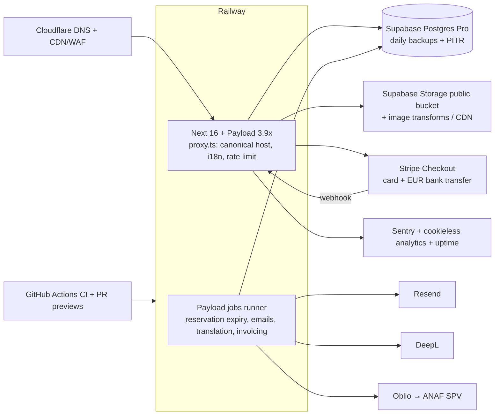

# Roadmap: from "works" to best-in-class

Written 2026-10-24. Ecosystem facts were checked against vendor sources on that date; links are
inline. Re-verify anything older than about 3 months before acting on it.

## 0. North star

> The most trusted place on the internet to discover, hear and buy a handmade Romanian string
> instrument.
>
> A musician anywhere can:
> - see and hear each instrument as if they were in the workshop,
> - trust the maker, and
> - reserve or pay safely in their own language.
>
> Paul can run it from his phone in minutes a day.

**What "done" looks like:**

| Area | Target |
|---|---|
| Trust and safety | No known critical or high vulnerabilities. Every public endpoint authorised and rate-limited. Backups tested |
| Performance | p75 LCP < 2.0s on 4G for home, gallery and product. TTFB < 300ms for cached pages |
| SEO | Every instrument indexable in 8 languages with `Product` JSON-LD and hreflang. Sitemap submitted |
| Conversion | Reservation/inquiry funnel measured end-to-end. Abandoned holds released automatically |
| Operations | Paul spends < 5 min per new instrument. Order and instrument state stay consistent without manual double entry |
| Engineering | CI gate on every PR, preview environment, documented runbooks, ADRs for every architectural change |

## Phase 0: make it safe (week 1, ~3–4 days)

1. **Ship the private-audit fixes**: access control, abuse protection, auth-flow fixes. See
   known-issues K-2.
2. **Patch Next.js** (K-1).
   - Same day (done 2026-10-24): pnpm override `sharp 0.35.5`, remote image hosts removed.
   - Then upgrade to **Payload 3.92.0 + Next ≥16.4.3 + React 19.3.x**. Next 16.4.0 is itself in
     the range of two critical advisories.
     - Payload 3.92's peer range only allows patched Next on the 16 line.
     - Next 16 changes: `middleware.ts` → `proxy.ts` (the old name is deprecated but still works),
       Turbopack by default, `next lint` removed.
   - Sources: [Payload releases](https://github.com/payloadcms/payload/releases),
     [Next 16](https://nextjs.org/blog/next-16),
     [Next support policy](https://nextjs.org/support-policy).
3. **Pin the runtime**: Node 24 LTS (`engines`, `.nvmrc`; Payload 3.92 needs `^22.23.4 || >=24.22.1`)
   and `packageManager: pnpm@10.29.2`.
   - Node 20 went EOL on 2026-04-30 ([Node releases](https://nodejs.org/en/about/previous-releases)).
4. **Railway**: migrate `railway.toml` to `.railway/railway.ts` **before 2026-12-01**
   ([docs](https://docs.railway.com/config-as-code)).
   - Decide what the second active Railway project is for, then delete it or make it real staging.
5. **Data safety**: confirm the Supabase plan.
   - The Free plan has **no backups** and pauses after a week of inactivity
     ([pricing](https://supabase.com/pricing)). Move production to Pro.
   - Take and test-restore a `pg_dump`.
6. **CI**:
   - GitHub Actions running install → `tsc` → lint → build → Playwright smoke test against a
     Postgres service container.
   - Protect `main` and require a PR.
7. **Health**: make `/api/health` check the DB (`SELECT 1`), so Railway stops calling broken deploys
   healthy.

## Phase 1: fix the foundations (weeks 2–3)

| Work | Why | Notes |
|---|---|---|
| Fonts, banner, hard-coded strings (K-6, K-11) | The brand currently renders in the system font | Hours, and the biggest visual win |
| **Reservation lifecycle** (K-5, K-8) | Holds never expire; double-booking is possible | `reservedUntil` + a Payload Jobs `waitUntil` release + a daily sweeper ([jobs docs](https://payloadcms.com/docs/jobs-queue/schedules)). Atomic conditional update. An `orders` hook syncs instrument status. Emails: "reservation expiring", "released" |
| **Translations** (K-4) | 7 of 8 languages show English product text | Fix the key, backfill, then make translation a job with retries. Optionally a "needs review" flag per locale so RO and DE get a human pass |
| Email reliability + localization (K-10, K-11) | Silent failures; English-only | Store `locale` on orders. Send through a job queue with retries. Shared `BrandEmailLayout`. Note: React Email 6 merged `@react-email/components` into `react-email`, so migrate the templates ([blog](https://resend.com/blog/react-email-6)) |
| Password change (K-7), cart persistence (K-9) | Broken or fragile UX | Hours |
| **Performance** (K-14, K-15, K-16) | Gallery TTFB 1.7s; images take 2s each | Static and ISR pages with tag revalidation on instrument change. Serve media from the public bucket or a CDN. Payload `imageSizes`. Lean session |
| **Technical SEO** (K-17, K-18) | Invisible to search beyond the brand name | Sitemap, robots, hreflang, canonical, OG image, `Product`/`Offer`/`LocalBusiness`/`Organization` JSON-LD. Slug convention + redirects. Descriptive titles and alt text |
| **Legal** (K-12) | Needed for an EU shop | Privacy policy (GDPR), terms of sale, 14-day withdrawal form, company identification, ANPC/SAL information. The EU ODR platform closed on 2025-07-20, so don't link it ([source](https://cms.law/en/deu/legal-updates/the-odr-platform-is-closing-what-businesses-need-to-know)). Romanian ANPC pictogram rules changed in 2026; verify the current order with a lawyer (sources disagree). Google Maps embed as click-to-load |
| Observability (K-20) | Flying blind | Cookieless analytics (no consent banner needed for analytics alone), Sentry, structured logs with the Railway request id, uptime monitor |
| Security headers (K-21) | Baseline hygiene | CSP (report-only first), HSTS, frame-ancestors, referrer policy |
| Clean-up (K-22–K-29) | Lower drag | Dead code, lockfile, compose file, env validation (zod), seed guard, business config module |

## Phase 2: real commerce (month 2)

**Decision 1: payments.** Keep reservations, but add an optional online path.

- **Recommended**: Stripe **Checkout Sessions**, with card plus **EUR bank transfer**
  (`customer_balance`, available to Romanian accounts, no amount cap). This fits €2k–€30k purchases
  ([bank transfers](https://docs.stripe.com/payments/bank-transfers)).
  - Webhook → Payload job → order `paid`, instrument `sold`, emails.
  - Optional **deposit to reserve** (e.g. 10%). This replaces the free-hold abuse surface with
    customer intent.
- Klarna works for Romanian merchants, but its RO limits are too low for most instruments
  ([Klarna](https://docs.stripe.com/payments/klarna)).
- **Don't** adopt `@payloadcms/plugin-ecommerce`. It is still beta, its inventory model is
  "rudimentary" with no holds, and one-of-a-kind items fit poorly
  ([docs](https://payloadcms.com/docs/ecommerce/plugin)).

**Decision 2: invoicing and tax.** Confirm with an accountant before building.

- Romanian B2C e-reporting through RO e-Factura applies to domestic B2C supplies. Law 88/2026 changed
  the rules for buyers identified only by CNP.
- One sale to an EU consumer can cross the €10k distance-selling threshold, which brings in OSS.
- Practical integration: an **Oblio** REST API job that issues the invoice and submits it to SPV on
  payment ([Oblio API](https://www.oblio.eu/api)). FGO and SmartBill are alternatives.

**Decision 3: customer auth.**

- `next-auth` v5 is still beta. Auth.js is now in maintenance under the Better Auth team, which
  recommends Better Auth for new projects
  ([announcement](https://github.com/nextauthjs/next-auth/discussions/13252)).
- Options:
  - **(a) Payload-native auth** with a separate `customers` auth collection: email/password, verify,
    forgot-password, sessions. One auth system, fewer moving parts. Google login needs a custom
    strategy.
  - **(b) Better Auth** against the same Postgres. Social login and passkeys work out of the box.
- **Recommendation**: (a) if Google login usage is low (measure first), otherwise (b). Either way,
  **split customers from admins** so a customer token can never reach `/admin`.

**Admin experience for Paul**:

- Branded admin (logo, colours).
- A dashboard: reservations needing action, holds expiring, recent inquiries.
- One-click actions: "mark paid", "release hold", "mark shipped".
- A mobile-friendly instrument-creation flow, with photo upload straight from the phone.
- A `settings` global for contact details, hours, reservation limit and banner text.
- An `inquiries` collection so contact messages live in the admin and not only in email.

## Phase 3: brand and growth (month 3+)

| Initiative | Outcome |
|---|---|
| Identity: wordmark/monogram, favicon set, OG templates | A premium, recognisable brand |
| Photography and sound standard: fixed shot list, consistent light, 360°/video, a standard audio recording per instrument (same room, same player, same excerpt) | Instruments can be compared by sight and sound. This is the biggest conversion lever for remote buyers |
| Instrument "passport" page: model history, wood provenance, build log photos, certificate PDF | Trust and storytelling. Supports premium pricing |
| Commission flow: guided "build me an instrument" inquiry (type, model, wood, varnish, budget, timeline) | Captures the custom-order business (3–6 months lead time) |
| Workshop visit / trial booking | Matches how high-value instruments are actually bought |
| Journal (Payload `posts` with Lexical): workshop stories, care guides, Reghin heritage | Organic search in 8 languages; content for Instagram |
| Google Business Profile + review prompts after delivery; reviews pulled dynamically instead of hard-coded | Social proof that stays fresh |
| Google Merchant Center free listings from `Product` feed | Discovery on Google Shopping |
| Newsletter (Resend audiences): "new instruments" alerts by type | Repeat traffic. Sell-through before listing |
| Accessibility to WCAG 2.2 AA | Good practice. The EAA's microenterprise exemption (<10 staff, ≤€2M) likely applies today, but don't rely on it as the shop grows ([CCPC guidance](https://www.ccpc.ie/business/enforcement/accessibility/european-accessibility-act-guidelines-for-microenterprises/)) |

## Target architecture (end of Phase 2)

## Payload v4 (watch, don't adopt yet)

v4 is in beta as of 2026-10-24.

**Changes that matter here:**

- The Local API defaults to `overrideAccess: false`. That's safer, but every Local API call must be
  reviewed.
- Versions are on by default, which needs migrations.
- Default `depth` drops from 2 to 1.
- Requires Node ≥ 24.22 and Next ≥ 16.4.
- Framework-agnostic (TanStack Start support).

Source: [migration guide](https://payloadcms.com/docs/beta/migration-guide/v4).

**Plan:** build Phases 0–2 on 3.9x while writing code v4-ready:

- explicit `overrideAccess` everywhere,
- explicit `depth`.

Migrate once v4 is stable. Payload was acquired by Figma in June 2025; the code stays MIT, so the
self-hosting risk is low ([announcement](https://payloadcms.com/payload-has-joined-figma)).

## Open decisions for the owner

1. Online payment: yes or no? With a deposit?
2. Legal entity and invoicing setup: who issues invoices today?
3. Target markets: which countries and languages actually convert? This decides whether 8 locales
   are worth maintaining, or whether to focus on RO/EN/DE/FR/JA.
4. Budget for photography and audio standardisation.
5. Who owns content: Paul alone, or with help?
